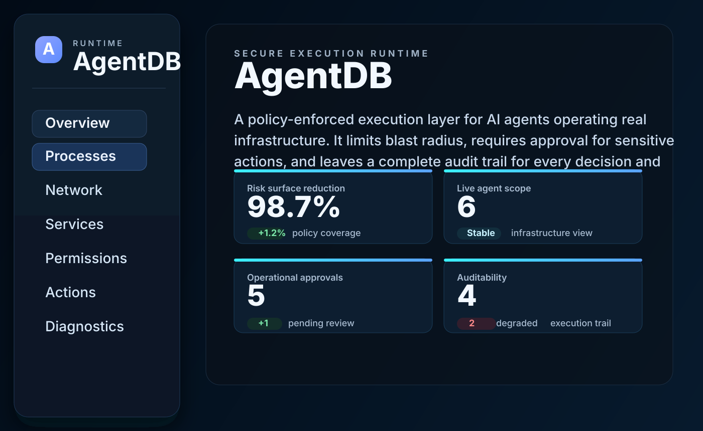

# AgentDB Runtime 



**Phase 1 — System State Mirror:** read-only mirror of live system state
(processes, network connections, services) using osquery as the
collector layer, normalized into Postgres, exposed over a small,
authenticated HTTP API.

**Phase 2 — Permission & Capability Engine:** every agent's authority is
now data — `agents`, `capabilities`, and `grants` tables, enforced
through a single choke point (`permissions::check_permission`) that logs
every allow/deny decision to an append-only `permission_checks` table.

**Phase 3 — Transactional Action Engine:** agents can now actually act on
the host — stop/start a process, adjust a cgroup limit, restart a
service — but only through `propose → approve → execute`, gated by
Phase 2's `check_permission` at proposal time. Every action type has both
a real implementation and a dry-run (simulation) implementation behind a
single toggle (`ACTIONS_DRY_RUN`, default **on** — real execution is
opt-in, not opt-out). See "Phase 3: actions walkthrough" below before
running anything with `ACTIONS_DRY_RUN=false`.

## Status

Phase 1 (system state mirror) is MVP-standard: known issues found across
several review passes — CPU-usage semantics, network-row deduplication,
PID-reuse identity, the reader-role permission-grant gap, hardcoded
`CLK_TCK`, missing rate limiting, a manual-only osquery-resilience check,
and the lack of integration test coverage — have all been fixed, and all
four Phase 1 exit criteria are automated.

Phase 2 (permission & capability engine) is built on top of it:
`agents`/`capabilities`/`grants`/`permission_checks` tables, a single
enforcement choke point (`permissions::check_permission`) with full unit
test coverage of its scope-matching edge cases, a complete HTTP surface
(issue/revoke grants, inspect decisions), and an integration test suite
covering every exit criterion from `phase2-permission-engine.md` §8 plus
several it didn't call out explicitly (agent/capability leakage between
grants, the expired-vs-scope-mismatch priority rule, reactivation after
suspension). A later review pass also closed a TOCTOU race in grant
revocation and an inconsistent-error-format gap across every write
endpoint — see `src/extract.rs`.

Phase 3 (transactional action engine) is built on top of both: four
action handlers (`process.stop`/`start`, `cgroup.set_limit`,
`service.restart`), each with a real implementation and a dry-run
implementation gated by a single server-level toggle
(`ACTIONS_DRY_RUN`). `propose_action` calls Phase 2's
`check_permission` directly in-process. Tests cover permission gating at
proposal time, approval-race safety (the same class of bug fixed in
Phase 2's `revoke_grant`), and — the part most worth independently
verifying — that the dry-run ceiling actually holds: a request asking for
real execution against a forced-dry-run server provably never reaches
the real code path, proven by checking the handler's structured output
rather than just trusting the flag.

Phase 4 (event-sourced audit trail) retrofitted Phases 2–3's write paths
to open one transaction spanning their state change and their event —
not a purely additive change, since bolting events on as a second write
would have left the exact gap this architecture exists to prevent. A
validation pass caught and fixed two real bugs (a silently-dropped
`agent_id` filter when combined with `since`; a client-side clock read
for `completed_at` that could race against Postgres's own `now()`), and
closed all three outstanding doc exit criteria: DB-level append-only
enforcement (via a trigger, not `REVOKE` — table owners bypass `REVOKE`
on their own tables, a trap worth understanding, not just avoiding), a
100k-row volume benchmark, and an aggregate `permission_checks`-vs-events
cross-check.

Phase 5 (MCP-native tool registry) is the HTTP-only version by design —
the permission-aware list/call pattern over JSON, not a wire-protocol-
compliant MCP server. List-time filtering is deliberately coarse;
call-time enforcement never adds a second check on top of
`propose_action`'s real one. Read-only tools reuse the exact same
pool-level query functions as the Phase 1 HTTP handlers, extracted
specifically to avoid duplicating that SQL in a second place.

Phase 6 (the demo loop) adds `POST /diagnose` with two interchangeable
modes behind one switch (`DIAGNOSIS_MODE`): a rule-based engine (pure
Rust, fully tested, always available) and an LLM-backed path calling the
Anthropic API. Both modes see the exact same pre-gathered
`DiagnosticContext` — the structural property that makes "cite only
retrieved data" real rather than just instructed. **The LLM path has
never run against the real API in this environment** (no network
access here) — its request/response shape was verified against current
Anthropic documentation via web search before writing it, but that is
not the same as having tested it; see the Phase 6 walkthrough section
below before relying on it.

A later pass added a second LLM provider — `otari`, routing through the
[mozilla-ai/otari](https://github.com/mozilla-ai/otari) gateway instead
of (or alongside) calling Anthropic directly, via the official `otari`
Rust SDK crate, behind a new `LLM_PROVIDER` switch and a shared
`LlmBackend` trait that keeps the rest of the codebase provider-agnostic.
Same unverified status as the original Anthropic client — see the Phase
6 walkthrough's Otari section.

None of this has been compiled anywhere in this process — there's no
Rust toolchain in this container, not just no network — so `make check`
(unit + integration tests across all six phases) is the first thing to
run locally, and any build error found there should be reported back.
Three dependencies beyond the standard set are worth double-checking
resolve cleanly on first build: `nix` (Phase 3, Unix-only, real signal
handling), `reqwest` (Phase 6, Anthropic-direct provider), and `otari`
(Phase 6, Otari provider — **requires Rust 1.83+**, its own stated
minimum, a real constraint worth checking before anything else if the
build fails in a way the other dependencies wouldn't explain).

## Prerequisites

- Rust (stable, 2021 edition)
- Docker (for local Postgres) or an existing Postgres 14+ instance
- [osquery](https://osquery.io/downloads) installed and `osqueryi` on `PATH`
  - macOS: `brew install osquery`
  - Linux: see osquery's install docs for your distro's package repo
- `jq` (for `scripts/benchmark.sh`)

## Quickstart

```bash
cp .env.example .env
# edit .env: at minimum, set API_KEY (openssl rand -hex 32)

make up                      # starts Postgres via docker compose
export $(grep -v '^#' .env | xargs)
make run                     # builds + runs the server; migrations run automatically
```

In another terminal:

```bash
curl -H "X-API-Key: $API_KEY" "http://localhost:8080/processes?limit=10"
curl -H "X-API-Key: $API_KEY" "http://localhost:8080/processes?sort_by=cpu&limit=10"
curl -H "X-API-Key: $API_KEY" "http://localhost:8080/network"
curl -H "X-API-Key: $API_KEY" "http://localhost:8080/services"
curl -H "X-API-Key: $API_KEY" "http://localhost:8080/health/mirror"
curl -H "X-API-Key: $API_KEY" --get "http://localhost:8080/query" \
  --data-urlencode "sql=SELECT name, pid, cpu_percent FROM processes ORDER BY cpu_percent DESC NULLS LAST LIMIT 5"
curl "http://localhost:8080/healthz"   # liveness check, no key required if API_KEY unset — see note below
```

`/health/mirror` returns the last poll time, duration, and row count per
source. `scripts/benchmark.sh` automates the Phase 1 exit criteria
(latency, coverage, staleness) against a running server:

```bash
make bench
# or directly:
./scripts/benchmark.sh http://localhost:8080 "$API_KEY"
```

## Authentication

Every route, including `/healthz`, requires an `X-API-Key` header
matching the `API_KEY` environment variable. If `API_KEY` is unset, the
API is unauthenticated and a warning is logged at startup — acceptable
for local development against `localhost`, not once this is reachable on
any shared or external network, since the mirror endpoints expose live
process/network/service data.

## Rate limiting

A fixed-window limiter (`src/rate_limit.rs`) caps requests per minute,
keyed by API key when present and falling back to source IP otherwise
(so repeated requests with an *invalid* key are still throttled, not just
valid ones). Configured via `RATE_LIMIT_PER_MINUTE` (default 300).

This is in-memory and single-instance by design — correct for one
running copy of the service, not sufficient once this runs as multiple
replicas behind a load balancer (each replica would enforce its own
separate budget). Swap in a shared store (Redis, etc.) before relying on
it at that scale; the module is structured so that only `RateLimiter`'s
internals need to change; the middleware function and its wiring in
`main.rs` stay the same.

## Read-only enforcement for `/query`

Two independent layers, neither relied on alone:

1. **Code level (`src/query_guard.rs`):** a real tokenizer — tracking
   string literals, quoted identifiers, and comments — rejects anything
   that isn't a single `SELECT` (or `WITH ... SELECT`) statement, plus a
   keyword blocklist as a backstop. This is what stops
   `SELECT 1; DROP TABLE processes;` before it ever reaches Postgres; a
   naive `sql.starts_with("select")` check does not, since it only
   inspects the first word.
2. **Database level (`migrations/0002_readonly_role.sql`):** an
   `agentdb_reader` role with `SELECT`-only grants. `/query` runs on its
   own connection pool (`db::connect_readonly`), separate from the main
   pool used by the typed mirror endpoints — even a validator bypass
   nobody has thought of yet still can't write, because Postgres itself
   would reject the attempt.

Set `DATABASE_URL_READONLY` (see `.env.example`) before running beyond
local development; otherwise `/query` falls back to the main connection
with a loud startup warning.

**Keeping the reader role's grants current:** rather than relying on
`ALTER DEFAULT PRIVILEGES` (which only covers tables created by the same
role that ran the `ALTER` — fragile once a different role owns later
migrations), `db::ensure_reader_grants()` re-runs
`GRANT SELECT ON ALL TABLES IN SCHEMA public` on every startup. It's
idempotent and always reflects whatever tables currently exist,
regardless of which migration or role created them.

## Data correctness notes

Two things worth knowing if you're consuming this data downstream:

- **`cpu_percent`** is a rate — the delta in cumulative CPU ticks between
  the last two polls of a given process, divided by elapsed wall-clock
  time. It is `NULL` on the first observation of a process (no prior
  sample to diff against), which is meaningfully different from `0.0`
  (observed and genuinely idle). The tick-rate conversion reads the
  system's actual `CLK_TCK` via `sysconf(_SC_CLK_TCK)` once at first use
  (see `clk_tck()` in `src/ingest.rs`), falling back to 100.0 with a
  logged warning only if `sysconf` can't determine it.
- **PID reuse** is detected by comparing each poll's observed process
  start time against what's stored. If they differ for the same PID,
  it's treated as a new process identity: `started_at` is overwritten and
  the CPU-rate baseline resets, rather than silently diffing across two
  unrelated processes that happened to share a PID.

## One-off poll (no server)

```bash
cargo run --release -- poll-once
```

## Project layout

```
agentdb-runtime/
├── Cargo.toml
├── Makefile
├── docker-compose.yml
├── .env.example
├── .github/workflows/ci.yml
├── scripts/
│   ├── benchmark.sh         -- automates Phase 1 §6 latency/coverage/staleness
│   ├── resilience-test.sh   -- automates the failed-poll resilience check
│   └── events-benchmark.sh  -- automates Phase 4 §8's 100k+ row volume check
├── migrations/
│   ├── 0001_state_mirror.sql
│   ├── 0002_readonly_role.sql
│   ├── 0003_process_cpu_and_identity.sql
│   ├── 0004_network_connection_identity.sql
│   ├── 0005_permissions_core.sql
│   ├── 0006_permission_checks.sql
│   ├── 0007_seed_capabilities.sql
│   ├── 0008_actions.sql
│   ├── 0009_events.sql
│   ├── 0010_events_append_only.sql    -- trigger-based, not REVOKE — see its own comments for why
│   ├── 0011_tools.sql
│   └── 0012_seed_tools.sql
├── tests/
│   ├── common/mod.rs          -- shared test Postgres pool + table reset helper
│   ├── api_tests.rs           -- Phase 1 router integration tests (no osquery needed)
│   ├── ingest_tests.rs        -- Phase 1 ingest integration tests (needs osqueryi; auto-skips if absent)
│   ├── permissions_tests.rs   -- Phase 2: every exit criterion + edge cases (pure fn + HTTP)
│   ├── actions_tests.rs       -- Phase 3: permission gating, approval races, dry-run ceiling proof
│   ├── events_tests.rs        -- Phase 4: injected-failure atomicity, append-only trigger, aggregate cross-check
│   ├── tool_registry_tests.rs -- Phase 5: list-vs-call asymmetry, revocation races, shared-SQL reuse
│   └── diagnosis_tests.rs     -- Phase 6: context gathering, rule-based diagnosis, LLM-gated (auto-skips if unconfigured)
└── src/
    ├── lib.rs              -- library crate root; exposes modules to main.rs and tests/
    ├── main.rs             -- thin CLI binary: wires every Extension (auth, rate limit, actions, diagnosis), shutdown
    ├── api.rs              -- Phase 1 HTTP routes + shared JSON error envelope + shared query_* functions
    ├── permissions.rs      -- Phase 2: scope matching + check_permission/check_permission_tx, with unit tests
    ├── permissions_api.rs  -- Phase 2 HTTP routes: agents, capabilities, grants, permission-checks
    ├── actions.rs          -- Phase 3: handler trait, 4 handlers (real + dry-run), propose/approve/execute
    ├── actions_api.rs      -- Phase 3 HTTP routes: propose/approve/list actions, action-type discovery
    ├── events.rs           -- Phase 4: event catalog, emit_event, agent_timeline/action_causal_chain/recent_events
    ├── events_api.rs       -- Phase 4 HTTP routes: agent timeline, causal chain, combined-filter feed
    ├── tool_registry.rs    -- Phase 5: list-time filtering, call-time enforcement, read/write tool dispatch
    ├── tool_registry_api.rs -- Phase 5 HTTP routes: /mcp/tools, /mcp/tools/call, admin /tools
    ├── diagnosis.rs        -- Phase 6: shared context gathering, rule-based engine, LLM client, mode switch
    ├── diagnosis_api.rs    -- Phase 6 HTTP route: /diagnose
    ├── auth.rs             -- X-API-Key middleware
    ├── rate_limit.rs       -- fixed-window rate limiter middleware
    ├── extract.rs          -- ValidatedJson/ValidatedQuery: consistent JSON error envelope on bad input
    ├── ingest.rs           -- osquery polling, CPU-rate calc, PID-reuse handling, unit tests
    ├── models.rs           -- typed rows + osquery raw-row deserialization
    ├── db.rs               -- connection pools (main + readonly) + migrations + grant refresh
    ├── query_guard.rs      -- single-statement SELECT validator, with unit tests
    └── query_util.rs       -- dynamic PgRow -> JSON for /query
```

## Exit criteria (Phase 1 doc §6)

All four now automated:

- [x] Query latency vs. raw `osqueryi` — `scripts/benchmark.sh`, warns if
      mirror is more than 3x raw osquery latency plus a 100ms margin
- [x] Row-for-row coverage — `scripts/benchmark.sh`, diffs PID sets
      between osquery and the mirror
- [x] Staleness bound — `scripts/benchmark.sh`, via `/health/mirror`,
      warns if any source hasn't completed a poll within 30s
- [x] Mirror survives a failed osquery poll without corrupting existing
      rows — `scripts/resilience-test.sh`, shadows `osqueryi` with a
      failing stub, confirms row count and content survive the failed
      cycle, then confirms a normal poll afterward recovers cleanly

```bash
make bench       # or: ./scripts/benchmark.sh
make resilience  # or: DATABASE_URL=... ./scripts/resilience-test.sh
```

## What's intentionally not here yet

- No `events` table yet — Phase 4 (event-sourced audit trail), layered on
  top of Phase 1–3 without changing anything here. Right now `actions`
  and `permission_checks` are the only audit trail; Phase 4 unifies
  everything (grants, actions, permission decisions) into one ordered,
  causally-linked event log.
- No compensation logic actually exercised yet. The `compensate` trait
  method and the `rolled_back`/`compensated` action statuses exist in the
  schema and the handler trait, but v0.1's `execute_action` only ever
  reaches `executed` or `failed` — compensation is only meaningful for a
  handler that reports a *partial* success before failing, and none of
  the four handlers built so far do that. Documented as a real gap in
  `actions.rs`, not silently assumed away.
- `process.stop`/`process.start`'s real paths are Unix-only
  (`#[cfg(unix)]`, using the `nix` crate for signals) — this project
  targets Linux hosts, so this is a scoping decision, not an oversight,
  but it means the crate won't compile real process control on Windows.
- Push/differential osquery logging (Phase 1 doc §3.2) — this is
  pull-mode only; swap in a logger-plugin listener later without
  touching the schema.
- Horizontal scaling of the HTTP layer — rate limiting is in-memory and
  per-instance (see the Rate limiting section above); running multiple
  replicas needs a shared limiter store first.
- No `sysconf`-verified CLK_TCK on non-Unix builds — falls back to 100.0
  there, since `sysconf` itself isn't available to check against.
- osquery's apt-repo install step in CI (`.github/workflows/ci.yml`) is
  best-effort (`continue-on-error: true`) — if osquery changes their
  install instructions upstream, that step can silently stop working.
  The osquery-gated integration tests degrade to skipping rather than
  failing CI in that case, which is the right failure mode, but it also
  means a broken install step could go unnoticed for a while. Worth an
  occasional manual check that `tests/ingest_tests.rs` is actually
  running (not skipping) in CI, not just that CI is green.

## Phase 2: permissions walkthrough

Every write endpoint below sits behind the same `X-API-Key` auth and rate
limiter as Phase 1 — no extra wiring needed, they're layered on for free.

```bash
# 1. Register an agent
curl -s -H "X-API-Key: $API_KEY" -H "content-type: application/json" \
  -X POST http://localhost:8080/agents -d '{"name":"demo-agent"}' | jq .
# => {"id": "...", "name": "demo-agent", "status": "active", "created_at": "..."}

# 2. See the fixed, seeded capability set
curl -s -H "X-API-Key: $API_KEY" http://localhost:8080/capabilities | jq .

# 3. Grant it permission to stop one specific process (scoped, time-limited)
curl -s -H "X-API-Key: $API_KEY" -H "content-type: application/json" \
  -X POST http://localhost:8080/grants -d '{
    "agent_id": "<id from step 1>",
    "capability_name": "process.stop",
    "scope": "pid:1234",
    "granted_by": "you@example.com",
    "expires_at": "2026-12-31T00:00:00Z"
  }' | jq .

# 4. See what it can do right now
curl -s -H "X-API-Key: $API_KEY" "http://localhost:8080/grants?agent_id=<id>" | jq .

# 5. Try a check (debug/inspection endpoint — not the real enforcement
#    call site; see the note in permissions_api.rs)
curl -s -H "X-API-Key: $API_KEY" -H "content-type: application/json" \
  -X POST http://localhost:8080/permissions/check -d '{
    "agent_id": "<id>",
    "capability_name": "process.stop",
    "scope": "pid:1234"
  }' | jq .
# => {"decision": "allowed", "grant_id": "...", "reason": null}

curl -s -H "X-API-Key: $API_KEY" -H "content-type: application/json" \
  -X POST http://localhost:8080/permissions/check -d '{
    "agent_id": "<id>",
    "capability_name": "process.stop",
    "scope": "pid:9999"
  }' | jq .
# => {"decision": "denied", "grant_id": null, "reason": "scope_mismatch"}

# 6. See why, after the fact
curl -s -H "X-API-Key: $API_KEY" "http://localhost:8080/permission-checks?agent_id=<id>" | jq .

# 7. Revoke it
curl -s -H "X-API-Key: $API_KEY" -H "content-type: application/json" \
  -X POST "http://localhost:8080/grants/<grant_id>/revoke" -d '{"revoked_by":"you@example.com"}' | jq .
```

### Denial reasons

| `reason` | Meaning |
|---|---|
| `no_grant` | No active grant exists for this agent+capability at all |
| `scope_mismatch` | A grant exists for the capability, but no grant's scope covers the request |
| `expired` | A grant whose scope *would* match has lapsed — reported in preference to `scope_mismatch` when both are true across different grants |
| `agent_suspended` | The agent exists but its status isn't `active` (covers both `suspended` and `retired`) |
| `agent_not_found` | The agent id doesn't exist at all — still logged (see the note on `permission_checks.agent_id` having no foreign key) |
| `capability_not_found` | The capability name doesn't exist |

### Scope matching — what to know before writing a grant's `scope`

- Exact string match always works.
- `"/workspace/**"` matches anything *under* `/workspace/` — but **not**
  the bare string `/workspace` itself. If you need both, grant
  `/workspace` separately, or use a single trailing `*`
  (`"/workspace*"`), which matches the bare prefix too.
- A `*` is only recognized as the very last character of the granted
  scope — `"api.*.example.com"` is not a middle wildcard, it's just a
  literal string that won't match anything but itself.
- `scope_matches` is pure and fully unit-tested in `src/permissions.rs` —
  when in doubt about a specific case, it's faster to read or extend
  those tests than to guess.

### What's deliberately out of scope for Phase 2

- No hierarchical/inherited scopes (a grant on `/workspace` does not
  imply anything about `/workspace/sub` unless you use `/**`).
- No role/group-based grants — every grant is one agent, one capability,
  one scope.
- `POST /permissions/check` is for manual testing and demos only. Phase
  3's action engine will call `permissions::check_permission` directly,
  in-process — not over HTTP — so that path doesn't exist as a network
  hop in the real enforcement flow.

## Phase 3: actions walkthrough

**Read this before setting `ACTIONS_DRY_RUN=false` anywhere.** With it
unset or `true` (the default), none of this touches the real host — every
handler's real system call is behind this one server-level toggle.

```bash
# 0. See what's available and whether each type can be undone
curl -s -H "X-API-Key: $API_KEY" http://localhost:8080/action-types | jq .

# 1. Propose an action (requires a matching grant from Phase 2 first —
#    see the Phase 2 walkthrough above)
curl -s -H "X-API-Key: $API_KEY" -H "content-type: application/json" \
  -X POST http://localhost:8080/actions -d '{
    "agent_id": "<id>",
    "action_type": "service.restart",
    "parameters": {"service_name": "nginx"}
  }' | jq .
# => {"id": "...", "status": "proposed", "grant_id": "...", ...}
#    or {"status": "failed", "error": "permission denied: scope_mismatch", ...}

# 2. Approve it — this immediately triggers execution too (see the note
#    in actions_api.rs on why there's no separate /execute endpoint)
curl -s -H "X-API-Key: $API_KEY" -H "content-type: application/json" \
  -X POST "http://localhost:8080/actions/<id>/approve" -d '{"approved_by":"you@example.com"}' | jq .
# => {"status": "executed", "effective_dry_run": true,
#     "outcome": {"dry_run": true, "would_restart": "nginx"}, ...}

# 3. See the full history for an agent, or filter by status
curl -s -H "X-API-Key: $API_KEY" "http://localhost:8080/actions?agent_id=<id>" | jq .
curl -s -H "X-API-Key: $API_KEY" "http://localhost:8080/actions?agent_id=<id>&status=failed" | jq .
```

### The dry-run toggle, precisely

Two layers, and only one of them is a real "switch":

1. **`ACTIONS_DRY_RUN`** (server-level, env var, read once at startup) —
   this is the actual toggle. `true`/unset: every action simulates,
   regardless of what any request asks for. `false`: real execution is
   allowed.
2. **`dry_run` on an individual `POST /actions` request** — can only ask
   for *more* caution than the server already requires. There is no way
   for a client to request real execution when the server is configured
   for dry-run; `effective_dry_run = server_forced || requested_dry_run`.

Every executed action records both `requested_dry_run` (what was asked
for) and `effective_dry_run` (what actually ran) — so the history never
requires guessing which mode a completed action ran in.

### What each handler actually does on the real path

| `action_type` | Real effect | Reversible? |
|---|---|---|
| `process.stop` | `SIGTERM`, then `SIGKILL` after 3s if still alive | No — a stopped process can't resume as the same process; starting a replacement is a separate, explicit `process.start` |
| `process.start` | Spawns the given command | Yes — compensates by `SIGTERM`-ing the new pid |
| `cgroup.set_limit` | Writes `memory.max` under the given cgroup path | Yes — reads and records the previous value first, compensates by restoring it |
| `service.restart` | `systemctl restart <service_name>` | No — a restart has no meaningful undo |

### What's deliberately out of scope for Phase 3

- Every action type requires human approval — no exceptions yet. Full
  autonomy (skip-approval) is a documented future per-action-type opt-in,
  not something this version supports.
- No automatic compensation on failure (see the note in the "what's
  intentionally not here yet" list above) — a failed `execute()` is
  recorded as `failed` with the error; nothing attempts to undo a partial
  effect, because none of the four handlers can currently report one.
- `process.stop` and `process.start`'s real implementations are
  Unix-only.

## Phase 4: events walkthrough

Every write path from Phases 2–3 (agent creation, grant issuance/revocation,
permission checks, action propose/approve/execute) now emits an event in
the *same transaction* as the state change it describes — an event's
existence is proof the thing it describes actually happened.

```bash
# Full timeline for one agent, newest first
curl -s -H "X-API-Key: $API_KEY" "http://localhost:8080/events?agent_id=<id>" | jq .

# What changed in the last 10 minutes (the Phase 6 demo query)
curl -s -H "X-API-Key: $API_KEY" \
  "http://localhost:8080/events?since=$(date -u -d '10 minutes ago' +%Y-%m-%dT%H:%M:%SZ)" | jq .

# The causal chain for one action — chronological (oldest first)
curl -s -H "X-API-Key: $API_KEY" "http://localhost:8080/events/actions/<action_id>" | jq .
# => [{"event_type": "ActionProposed", ...}, {"event_type": "ActionApproved", ...}, {"event_type": "ActionExecuted", ...}]
```

### The atomicity retrofit

Phases 2–3's write functions (`check_permission`, `propose_action`,
`approve_action`, `create_grant`, `revoke_grant`, `create_agent`) were
originally written against `&PgPool` directly, not an explicit
transaction. Bolting event emission on as a second, separate write after
each one would have left the exact gap this architecture exists to
prevent: the state change could succeed while its event failed
independently. Fixing that required a real retrofit, not just an
additive change:

- `permissions::check_permission` split into a pool-based wrapper
  (unchanged signature, still used standalone) and
  `check_permission_tx`, which runs within a caller's already-open
  transaction — no Postgres savepoint needed, it just issues more
  queries against the same transaction.
- `propose_action`/`approve_action`/`create_grant`/`revoke_grant`/
  `create_agent` each open one transaction spanning their state change
  and their event, committed together.
- `execute_action` is the one exception, deliberately: holding a
  transaction open across a real system call (`process.stop`'s 3-second
  signal grace period, `service.restart`'s unbounded `systemctl` call)
  would hold a Postgres connection and row locks for that whole time.
  It uses two short transactions bracketing the untransacted real work —
  see the function's doc comment in `actions.rs` for the full reasoning.

### Exit criteria (phase4-event-store.md §8)

All now closed:

- [x] Every `PermissionAllowed`/`PermissionDenied` decision has a
      corresponding event row — proven at aggregate scale, not just per-case:
      `permission_checks_and_events_counts_match_exactly_over_a_mixed_batch`
      runs 8 varied outcomes (allowed, scope-mismatch, no-grant, suspended
      agent, unknown capability, unknown agent, both via the standalone
      `check_permission` and via `propose_action`'s transaction-participating
      `check_permission_tx`) and asserts the two tables agree exactly, down
      to the allowed/denied breakdown, not just the totals.
- [x] Every `actions.status` transition has a corresponding event row, in
      the same transaction — verified by the injected-failure test
      (`transaction_failure_leaves_neither_state_change_nor_event`).
- [x] Full timeline reconstruction returns events in correct causal order
      via `sequence` — `full_causal_chain_is_proposed_then_approved_then_executed_in_order`.
- [x] `UPDATE`/`DELETE` on `events` fails at the database level, not just
      application logic — closed via `migrations/0010_events_append_only.sql`.
      Worth understanding why this needed a trigger rather than the more
      obvious `REVOKE`: the role that runs migrations owns the table (and is
      the instance superuser in the default `docker-compose` dev setup), and
      Postgres table owners bypass `REVOKE`-based restrictions on their own
      tables entirely — a plain `REVOKE` here would have compiled, run, and
      silently done nothing. A trigger fires regardless of ownership, which
      is what `events_table_rejects_update_even_from_the_owning_role` and
      its `DELETE` counterpart specifically prove.
- [x] Performs acceptably at realistic volume (100k+ rows) —
      `scripts/events-benchmark.sh` (`make events-bench`) seeds 150k rows via
      `generate_series` and times the three real query shapes
      (`recent_events` with/without an agent filter, `action_causal_chain`),
      plus an `EXPLAIN` check that the plan actually uses an index rather than
      a sequential scan.

### What's deliberately out of scope for Phase 4

- `AgentSuspended`/`AgentReactivated` are defined in the event catalog
  but never emitted — there's no HTTP endpoint yet that changes an
  agent's status (Phase 2 never built one; tests simulate it via direct
  SQL). Adding that endpoint is natural future work, not done here to
  avoid scope creep into Phase 2 territory.
- No tamper-evidence (hash chaining) beyond the append-only trigger — a
  trigger stops accidental/malicious mutation via SQL, but doesn't make
  the log cryptographically provable as untampered to a third party.
  Flagged as a known extension point in phase4-event-store.md §7, not
  built in v0.1.
- **No recovery from a stuck `executing` action.** If the process
  crashes between `execute_action`'s two short transactions (see the
  long comment at that spot in `actions.rs`), an action can be left
  permanently in `executing` status with no terminal event ever
  recorded. This is the single largest real risk in the engine — found
  during review, documented in code rather than quietly left, but not
  fixed here: proper recovery needs a human-decidable policy (retry vs.
  mark failed vs. flag for manual review), since whether the real-world
  effect actually happened isn't knowable from the DB alone after a
  crash mid-call.
- No `GET /audit/export?format=csv` — phase4-event-store.md §6 mentions
  it as a flattened export for handing to a compliance reviewer, but it
  wasn't in the doc's explicit exit-criteria checklist, so it's deferred
  rather than built speculatively.

A validation pass after the initial build also caught and fixed two real
bugs, both with regression tests in `tests/events_tests.rs`: `GET
/events?agent_id=X&since=Y` was silently dropping the `agent_id` filter
whenever `since` was also present (the match logic matched a wrong,
wider case than intended); and `completed_at` on a denied proposal was
computed via a Rust-side clock read taken before the query was even
sent, rather than the same Postgres-side `now()` every other timestamp
in this schema uses — a latent clock-skew hazard once the app and
database run on separate hosts.

## Phase 5: tool registry walkthrough

Agents never get raw system access — they see and call only the tools
their current grants allow, via a Phase-2-and-3-backed registry. This is
the HTTP-only version described in phase5-tool-registry.md, not a
wire-protocol-compliant MCP server (no JSON-RPC, no stdio/SSE transport)
— that's real future work, not built here.

```bash
# What can this agent see right now (coarse, capability-level)
curl -s -H "X-API-Key: $API_KEY" "http://localhost:8080/mcp/tools?agent_id=<id>" | jq .

# Call a write tool — routes through the exact same propose_action flow
# as POST /actions directly, including the approval gate
curl -s -H "X-API-Key: $API_KEY" -H "content-type: application/json" \
  -X POST http://localhost:8080/mcp/tools/call -d '{
    "agent_id": "<id>",
    "tool_name": "service.restart",
    "parameters": {"service_name": "nginx"}
  }' | jq .
# => {"id": "...", "status": "proposed", ...} — read `status` exactly as
#    you would from POST /actions; there's no separate "pending" wrapper

# Call a read tool
curl -s -H "X-API-Key: $API_KEY" -H "content-type: application/json" \
  -X POST http://localhost:8080/mcp/tools/call -d '{
    "agent_id": "<id>",
    "tool_name": "query.processes",
    "parameters": {"sort_by": "cpu", "limit": 10}
  }' | jq .

# Admin: see the full registry, or add a tool
curl -s -H "X-API-Key: $API_KEY" http://localhost:8080/tools | jq .
```

### List-time vs. call-time — the asymmetry that makes this safe

`GET /mcp/tools` is deliberately coarse: an agent sees a tool if it holds
*any* active grant for the required capability, regardless of scope. A
grant scoped to one specific PID still surfaces `process.stop` in the
list. The precise, scope-specific decision happens only at
`POST /mcp/tools/call` time, through the same `check_permission`/
`propose_action` path every other write in this codebase uses — **never**
a second check invented for this endpoint. A tool visible in the list can
still be denied at call time; `revocation_between_list_and_call_denies_the_call`
in `tests/tool_registry_tests.rs` proves this directly, including that the
denial still lands in the event trail from Phase 4.

### Where SQL would have been duplicated — and wasn't

`query.processes`/`query.network`/`query.services` call the exact same
pool-level functions (`api::query_processes`, `query_network`,
`query_services`) that back the Phase 1 HTTP endpoints — extracted
specifically so this phase didn't duplicate that SQL in a second place,
where the two copies could drift apart under a future bug fix applied to
only one of them.

### What's deliberately out of scope for Phase 5

- **No real MCP protocol.** `/mcp/tools` and `/mcp/tools/call` implement
  the permission-aware list/call *pattern* the doc describes, over plain
  JSON/HTTP — not MCP's actual JSON-RPC wire format or stdio/SSE
  transport. A real MCP server is a distinct, substantial piece of
  engineering (likely via a dedicated Rust MCP SDK), deferred
  intentionally rather than built partially.
- All three read-only tools share the `filesystem.read` capability —
  the seeded set from migration 0007 has no finer-grained read
  capability (e.g. nothing distinguishes "can list processes" from "can
  list network connections"). Introducing one is natural future work.
- No tool versioning or deprecation — `tools.name` is globally unique
  with no revision concept.

## Phase 6: the demo loop

`agentdb ask "why is my machine slow?"` and `"can you fix it?"`, as
described in phase6-demo-loop.md — two modes behind one switch, not two
separate implementations to choose between once and live with.

```bash
# Diagnose (defaults to the server's configured mode)
curl -s -H "X-API-Key: $API_KEY" -H "content-type: application/json" \
  -X POST http://localhost:8080/diagnose -d '{"agent_id": "<id>"}' | jq .
# => {"mode": "rule_based", "summary": "Process 'runaway-worker' (pid 8842) is using
#     94.0% CPU...", "suggested_action": {"action_type": "process.stop",
#     "parameters": {"pid": 8842}, "reasoning": "..."}, "context": {...}}

# Force a specific mode for this one call, regardless of the server default
curl -s -H "X-API-Key: $API_KEY" -H "content-type: application/json" \
  -X POST http://localhost:8080/diagnose -d '{"mode": "llm", "agent_id": "<id>"}' | jq .

# "Can you fix it?" — take the suggested_action and propose it for real,
# through the exact same engine every other action in this project uses
curl -s -H "X-API-Key: $API_KEY" -H "content-type: application/json" \
  -X POST http://localhost:8080/mcp/tools/call -d '{
    "agent_id": "<id>", "tool_name": "process.stop", "parameters": {"pid": 8842}
  }' | jq .
# then approve it exactly as in the Phase 3 walkthrough
```

### The switch, precisely

`DIAGNOSIS_MODE` (env var, default `rule_based`) sets the server default;
`POST /diagnose`'s own `mode` field can request either mode per-call,
**unrestricted** — unlike Phase 3's `ACTIONS_DRY_RUN` ceiling, there's no
safety asymmetry between the two diagnosis modes (neither can touch the
host; only actually proposing the suggested fix can, and that step is
unaffected by which mode suggested it). Requesting `llm` when it isn't
configured is always a clear 400, never a silent fallback to rule-based.

### What's shared between the two modes, and why that's the important part

Both modes receive the exact same `DiagnosticContext` — gathered once, in
`diagnosis::gather_context`, before either mode runs. Rule-based reasons
over it with fixed Rust logic. LLM mode serializes it into a single
grounded prompt and asks Claude to reason over it. Neither mode can see
anything the other can't, which is what makes "cite only retrieved data"
a structural property of this design rather than an instruction either
mode could ignore.

### Read this before setting `DIAGNOSIS_MODE=llm` or passing `"mode": "llm"`

**The LLM path has never run against the real Anthropic API in this
build.** This environment has no network access, so nothing past "does
it compile" has been verified — not the request shape, not response
parsing, not real-world error handling. The request/response shape
(`POST /v1/messages`, `x-api-key` + `anthropic-version: 2023-06-01`
headers, `model`/`max_tokens`/`messages` body) was checked against
current `docs.anthropic.com` documentation via web search before writing
the client, rather than relied on from memory — but "checked against
docs" is not "tested against the live API." Treat `src/diagnosis.rs`'s
`AnthropicClient` as a real first draft to validate with an actual key,
not as proven code. `tests/diagnosis_tests.rs`'s
`llm_diagnosis_runs_against_the_real_api_when_configured` is written and
ready — it checks for `ANTHROPIC_API_KEY`/`ANTHROPIC_MODEL` and skips
gracefully if absent (the same pattern Phase 1's osquery-gated tests
use), so running it for real is just a matter of setting those two
variables and re-running `cargo test`.

Also worth knowing: the LLM path is a **single grounded prompt, not an
agentic tool-calling loop**. phase6-demo-loop.md's architecture diagram
shows the agent calling `query.processes`/`query.network`/`events`
itself via tool access — building that for real (multi-turn
`tool_use`/`tool_result` exchanges) is substantially more engineering
than this phase's scope, and would be just as unverified as the simpler
form, with more surface area for something to be wrong. This simpler
shape keeps the one property that actually matters (the model only ever
sees pre-retrieved, trusted data) without that added risk. Swapping in
real tool-calling later replaces `AnthropicClient::diagnose`'s body; it
doesn't change anything else.

No hardcoded model name, deliberately — `ANTHROPIC_MODEL` must be set
explicitly when using LLM mode, rather than this code asserting a
specific model string that might be stale by the time anyone reads it.

### Not locked into the Claude API: the Otari gateway provider

LLM mode has two interchangeable backends behind `LLM_PROVIDER`
(`anthropic_direct`, the default, or `otari`) — a second switch,
independent of `DIAGNOSIS_MODE`, selecting *which* backend implements
`llm` mode when it's used. Both implement the same `diagnosis::LlmBackend`
trait, so nothing else in this codebase — `diagnose_api.rs`, the
top-level `diagnose()` function, the rule-based engine, Phase 3's action
engine — knows or cares which one is active.

`otari` routes through a self-hosted or platform instance of
[mozilla-ai/otari](https://github.com/mozilla-ai/otari), an open-source
gateway that exposes one OpenAI/Anthropic-compatible endpoint in front
of 40+ providers. This is what actually answers "don't rely only on the
Claude API" — the direct client alone can't reach OpenAI, local models,
or anything else; routing through Otari can, without this project's own
code needing to know which provider is actually serving a given request.

```bash
# Run a local Otari gateway first — see mozilla-ai/otari's own README
# for setup. Then:
LLM_PROVIDER=otari
OTARI_API_KEY=<your gateway key>
OTARI_API_BASE=http://localhost:8000/api/v1
OTARI_MODEL=anthropic:claude-opus-4-20250514   # or openai:gpt-4o-mini, etc.
```

Implementation notes worth knowing:

- Built on the **official `otari` Rust SDK crate** (crates.io, pinned to
  `0.0.1`), not a hand-rolled HTTP client. This was a deliberate choice,
  not laziness: Otari's self-hosted auth uses a custom
  `Otari-Key: Bearer <key>` header, genuinely different from both
  OpenAI's `Authorization: Bearer` and native Anthropic's `x-api-key` —
  confirmed via web search of the SDK's own source rather than guessed,
  and using the gateway maintainers' own client sidesteps the risk of
  getting that wrong from fragmented documentation.
- The SDK reads `OTARI_API_KEY`/`OTARI_API_BASE` itself — this project
  doesn't duplicate that configuration, only `OTARI_MODEL`, since the
  SDK takes the model as a per-call `"provider:model"` string rather
  than an env var.
- **Same unverified status as the direct Anthropic client, stated
  plainly again because it matters just as much here**: this has never
  run against a real gateway in this environment — no network access
  means no runtime verification beyond "does it compile." The API
  surface (`otari::completion()`, `Message::user()`,
  `response.content()`) was confirmed from the crate's own published
  source and README via web search, not memory — but confirmed-from-docs
  is not tested-against-a-live-gateway.
  `tests/diagnosis_tests.rs`'s `otari_diagnosis_runs_against_a_real_gateway_when_configured`
  is written and ready, gated exactly like the Anthropic one — set the
  three `OTARI_*` variables and it runs for real.
- **Requires Rust 1.83+** (the `otari` crate's own `rust-version`) —
  worth checking first if `cargo build` fails in a way the other
  dependencies wouldn't explain.

### What's deliberately out of scope for Phase 6

- No real multi-turn agentic tool-calling (see above) — applies to both
  LLM providers equally.
- The LLM path's `SUGGESTED_ACTION:` line is parsed with a best-effort,
  deliberately narrow parser (`process.stop` only) — extending it to the
  other three action types is a bounded, mechanical follow-up, not a
  redesign; see the doc comment on `extract_suggested_action`. Shared by
  both providers, so fixing it once fixes it for both.
- No fleet-wide or multi-host diagnosis — this is a single-host loop.
- No fully unattended "diagnose and fix automatically" mode — every
  suggested fix still requires the normal explicit propose + approve
  steps; nothing in this phase bypasses Phase 3's approval gate.
- No third `LlmBackend` implementations beyond Anthropic-direct and
  Otari — adding one (a different gateway, a local model server) means
  implementing the trait and extending `LlmProvider`/`from_env()`, not a
  redesign of anything else in `diagnosis.rs`.

## Contributing

See `CONTRIBUTING.md` for conventions (migration rules, error-handling
pattern, how to add a new osquery-backed table) and the pre-PR checklist.
`make check` runs everything CI runs.
